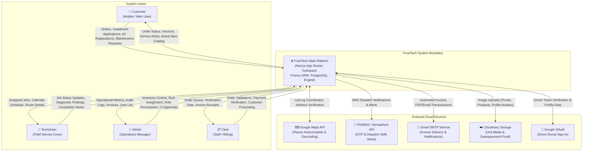
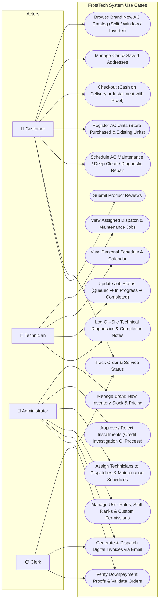
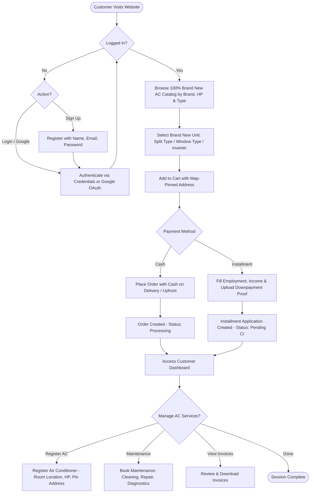
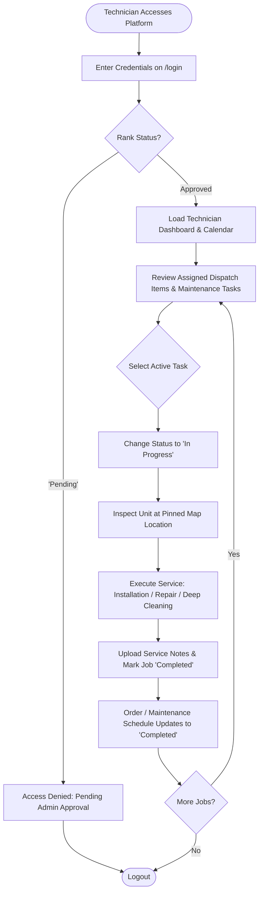
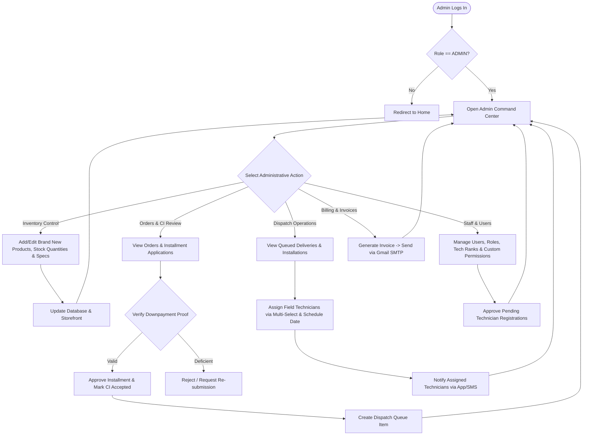
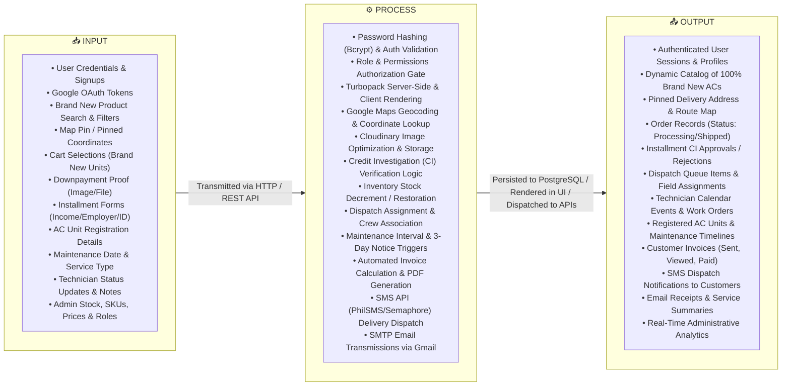

# FrostTech - System Architecture & Specification Diagrams

This document contains the complete and verified software architecture diagrams for **FrostTech**, including the Level-0 System Context Diagram, Use Case Diagram, User Activity Flowcharts (Customer, Technician, Admin, Clerk), the Entity Relationship Diagram (ERD), and the Input-Process-Output (IPO) Model.

> **Operational Note:**
> 1. All commercial air conditioning units sold by FrostTech are **100% Brand New** (Factory-sealed units with official manufacturer warranty; no second-hand or refurbished units).
> 2. On-site technician material requisitions (`TechRequest`) have been removed from system scope; technician workflows center strictly on installation, cleaning, diagnostic repair, and job completion reporting.

---

## 1. System Context Diagram (Level 0)

---

## 2. Use Case Diagram

---

## 3. User Flowcharts

### 3.1. Customer Process Flowchart

---

### 3.2. Technician Process Flowchart

---

### 3.3. Administrator Process Flowchart

---

### 3.4. Clerk Process Flowchart

---

## 4. Entity Relationship Diagram (ERD)

```mermaid
erDiagram
    users {
        String id PK
        String email UK
        String password
        String firstName
        String lastName
        String phone
        Role role "CUSTOMER | ADMIN | TECHNICIAN | CLERK"
        String techRank
        String permissions "JSON array of granted privileges"
        DateTime createdAt
        DateTime updatedAt
    }

    registered_acs {
        String id PK
        String userId FK
        String location
        String brandModel
        String acType
        String horsepower
        String paymentType
        Float totalPrice
        Int months
        Float pricePerMonth
        Float lat
        Float lng
        String fullAddress
        Boolean purchasedFromStore
        Boolean isPaused
        Boolean isEnrolledMaintenance
        DateTime enrolledAt
        DateTime createdAt
        DateTime updatedAt
    }

    products {
        String id PK
        String slug UK
        String name
        String brand
        String category
        Float price
        Float originalPrice
        Float rating
        Int sold
        Int stock "Brand New Stock Counter"
        String image
        StringArray images
        String horsepower
        String badge
        StringArray specs
        String description
        DateTime createdAt
        DateTime updatedAt
    }

    reviews {
        String id PK
        String productId
        String userId FK
        String userName
        Int rating
        String comment
        DateTime createdAt
        DateTime updatedAt
    }

    inventory_items {
        String id PK
        String sku UK
        String brand
        String model
        String category
        String horsepower
        String description
        Int stock
        Float price
        String image
        StringArray images
        String status
        DateTime createdAt
        DateTime updatedAt
    }

    orders {
        String id PK
        String orderNo UK
        String userId FK
        String name
        String location
        String item
        String payment
        String status
        String date
        String downpaymentProof
        Boolean hasDownpayment
        Boolean notice3Days
        DateTime notice3DaysAt
        String hp
        String itemType
        Float price
        String assignedTech
        String scheduledDate
        DateTime createdAt
        DateTime updatedAt
    }

    installments {
        String id PK
        String appId UK
        String userId FK
        String name
        String item
        String date
        InstallmentStatus status "PENDING | CI_ACCEPTED | REPENDING | COMPLETED | REJECTED"
        String issue
        Int term
        String employer
        String income
        String idType
        String location
        String assignedTech
        String scheduledDate
        DateTime createdAt
        DateTime updatedAt
    }

    dispatch_items {
        String id PK
        String dispatchNo UK
        String type
        String customerId
        String name
        String location
        String item
        String notes
        String status
        String scheduledDate
        String assignedTechName
        String horsepower
        DateTime createdAt
        DateTime updatedAt
    }

    maintenance_schedules {
        String id PK
        String scheduleNo UK
        String customerId FK
        String name
        String phone
        String address
        String item
        String serviceType
        String scheduledDate
        String technicianId FK
        String technicianName
        MaintenanceStatus status "SCHEDULED | OVERDUE | COMPLETED"
        String notes
        DateTime createdAt
        DateTime updatedAt
    }

    calendar_events {
        String id PK
        String title
        String date
        String technician
        String type
        DateTime createdAt
    }

    addresses {
        String id PK
        String userId FK
        String label
        String fullAddress
        String phone
        Float lat
        Float lng
        Boolean isDefault
        DateTime createdAt
        DateTime updatedAt
    }

    cart_items {
        String id PK
        String userId FK
        String productId
        String name
        Float price
        String image
        Int quantity
        Boolean notice3Days
        DateTime notice3DaysAt
        DateTime createdAt
        DateTime updatedAt
    }

    invoices {
        String id PK
        String invoiceNo UK
        String type "ADMIN | CUSTOMER"
        String dispatchId
        String dispatchNo
        String customerName
        String serviceType
        String acUnit
        String location
        String technicianName
        String status "Sent | Viewed | Paid"
        Float amount
        String notes
        DateTime createdAt
        DateTime updatedAt
    }

    _TechnicianDispatch {
        String A FK "dispatch_items.id"
        String B FK "users.id"
    }

    %% Relationships
    users ||--o{ registered_acs : "owns"
    users ||--o{ orders : "places"
    users ||--o{ installments : "applies for"
    users ||--o{ addresses : "saves"
    users ||--o{ cart_items : "adds to"
    users ||--o{ maintenance_schedules : "requests as Customer"
    users ||--o{ maintenance_schedules : "assigned as Technician"
    users ||--o{ _TechnicianDispatch : "assigned to"
    dispatch_items ||--o{ _TechnicianDispatch : "assigned crew"
```

---

## 5. Input-Process-Output (IPO) Model

### 5.1. System-Level Visual IPO Diagram

---

### 5.2. Detailed Subsystem IPO Matrices

#### Module 1: User Authentication & Role Authorization
| **INPUT** | **PROCESS** | **OUTPUT** |
|---|---|---|
| • Email, password, first/last name, phone • Selected initial role (Customer, Technician) • Google OAuth token & profile payload • Password change requests (current & new password) | • Validate required payload fields & sanitize strings • Hash passwords using `bcryptjs` (salt rounds: 10) • Verify credentials against `users` table via Prisma • Check technician approval state (`techRank == 'Pending'`) • Evaluate user permissions JSON array for route access • Execute database schema self-healing DDL on startup | • Authenticated user session object (`id`, `role`, `name`) • JSON response: HTTP 200 (Success) or 401/403 (Error) • Redirect to role-specific portal (`/`, `/admin`, `/technician`) • Updated encrypted password record in database |

#### Module 2: E-Commerce Storefront, Inventory & Cart
| **INPUT** | **PROCESS** | **OUTPUT** |
|---|---|---|
| • Brand, horsepower, and category filter criteria (Brand New units) • Add-to-cart clicks with product ID & quantity • Delivery address and Google Maps pinpoint coordinates | • Query active brand-new products from catalog • Enforce mandatory login/registration check prior to cart addition • Upsert cart items into `cart_items` table • Compute subtotal, taxes, and shipping rates based on location • Validate inventory stock levels from `inventory_items` | • Interactive catalog cards for Brand New AC models • Updated user cart drawer with real-time total calculation • Pinned map marker displaying exact delivery drop point • Low stock badges and out-of-stock disable flags |

#### Module 3: Checkout, Orders & Payment Processing
| **INPUT** | **PROCESS** | **OUTPUT** |
|---|---|---|
| • Selected payment mode (`Cash on Delivery` or `Installment`) • Uploaded downpayment proof of payment (Base64 / Cloudinary URL) • Delivery contact details & delivery notes • Order cancellation / confirmation requests | • Generate unique order tracking number (`ORD-XXXX`) • Validate downpayment image format and store proof URL • Persist record to `orders` table with initial status `Processing` • Decrement product stock in `inventory_items` • Clear corresponding items from `cart_items` | • Order confirmation modal with unique Order No. • Customer order history record in Customer Space • Live entry populated in Admin Order Queue for verification • Real-time notification dispatched to Clerk/Admin dashboard |

#### Module 4: Installment Application & Credit Investigation (CI)
| **INPUT** | **PROCESS** | **OUTPUT** |
|---|---|---|
| • Applicant employment details, employer name, monthly income • Government ID type and number • Selected financing term (3, 6, 9, 12 months) • Admin CI evaluation action (`CI_ACCEPTED`, `REJECTED`, `REPENDING`) | • Create unique application record (`APP-XXXX`) in `installments` • Calculate monthly amortization: `(Price - Downpayment) / Term` • Admin credit assessment verification workflow • Transition installment state machine from `PENDING` to `CI_ACCEPTED` | • Application status badge displayed in Customer Space • Automated creation of delivery item in `dispatch_items` • Formal financing schedule breakdown for customer • SMS notification alert sent to customer phone via PhilSMS |

#### Module 5: Dispatch Operations & Technician Scheduling
| **INPUT** | **PROCESS** | **OUTPUT** |
|---|---|---|
| • Approved order / installment dispatch trigger • Service classification (`New Installation`, `Deep Cleaning`, `Repair`) • Admin technician multi-assignment selection • Target scheduled installation/service date | • Generate dispatch queue record (`DIS-XXXX`) in `dispatch_items` • Associate technicians via `_TechnicianDispatch` relation table • Create linked calendar schedule entry in `calendar_events` • Calculate technician daily workload and schedule conflicts | • Queued dispatch card visible in Dispatch Management board • Job alert populated in assigned Technician's mobile view • Calendar event entry on Technician schedule page • Route map pin with full delivery address and contact info |

#### Module 6: AC Unit Registration & Lifecycle Maintenance
| **INPUT** | **PROCESS** | **OUTPUT** |
|---|---|---|
| • AC brand/model, horsepower, unit room location (e.g. Master Bedroom) • Purchase origin (`purchasedFromStore` true/false) • Maintenance enrollment opt-in and preferred schedule date • Pause / resume maintenance toggle | • Insert record into `registered_acs` table linked to user ID • Automatically calculate recommended recurring maintenance due date • Evaluate 3-day notice window (`notice3Days` & `notice3DaysAt`) • Auto-create entry in `maintenance_schedules` (`MNT-XXXX`) | • Digital AC passport card displayed in Customer Space • Maintenance countdown meter and cleaning reminder badge • Proactive SMS/Email reminders 3 days before scheduled service • Service log tracking cleaning and diagnostic history |

#### Module 7: Technician Field Work & Execution
| **INPUT** | **PROCESS** | **OUTPUT** |
|---|---|---|
| • Technician task status update (`Queued` → `In Progress` → `Completed`) • On-site diagnostic inspection notes and service findings | • Validate technician assignment authorization • Update `dispatch_items` and `maintenance_schedules` status • Update corresponding customer order to `Completed` | • Real-time status update displayed on Customer tracking screen • Updated technician completed job count and performance stats • Historical service record logged for customer unit |

#### Module 8: Invoicing, Receipts & Cloud Communications
| **INPUT** | **PROCESS** | **OUTPUT** |
|---|---|---|
| • Completed dispatch ID or maintenance schedule ID • Service amount, technician name, customer name, unit details • Payment status updates (`Sent`, `Viewed`, `Paid`) • Invoice transmission trigger | • Generate unique invoice number (`INV-XXXX`) in `invoices` table • Compose structured HTML email receipt with line items • Authenticate with Gmail SMTP and deliver email to customer • Format SMS payload and invoke PhilSMS / Semaphore REST endpoint | • Formal invoice record with tracking status (`Sent` / `Paid`) • Customer invoice PDF / email delivered to customer inbox • Instant SMS text notification delivered to recipient phone • Revenue and accounting records updated in Admin dashboard |
