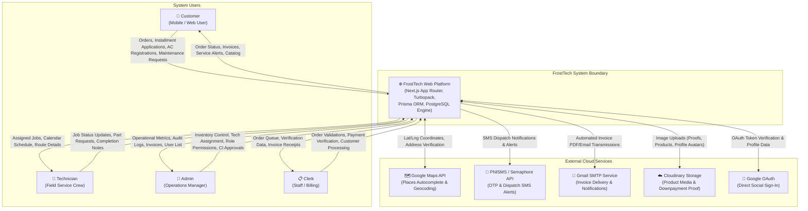
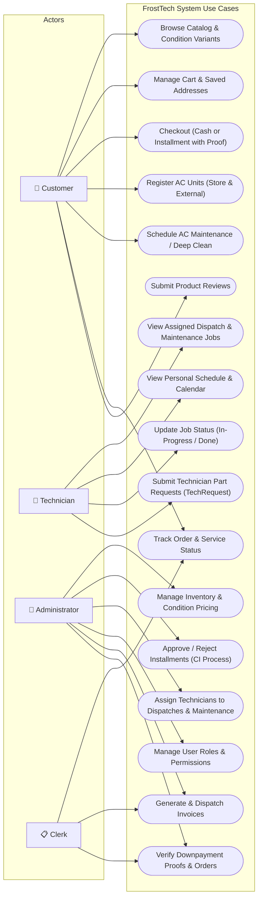
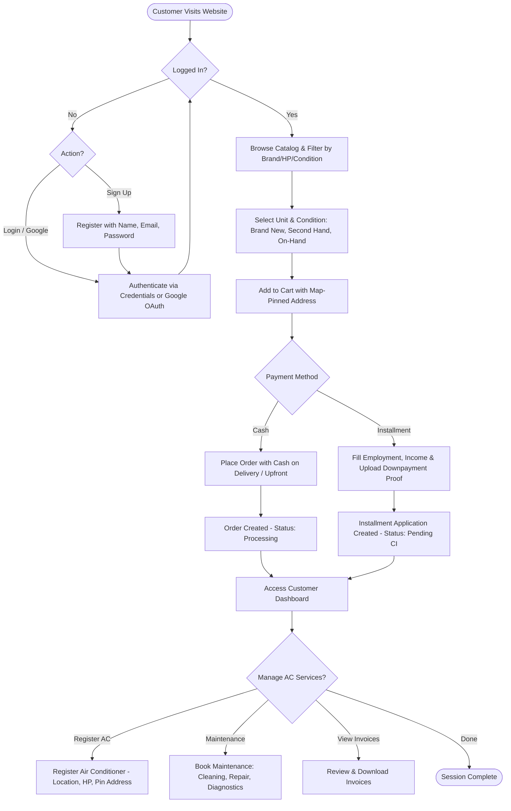
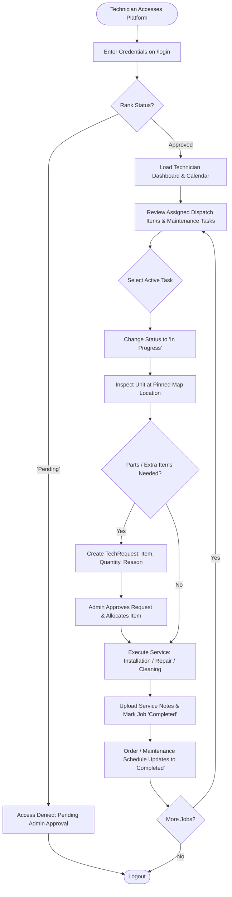
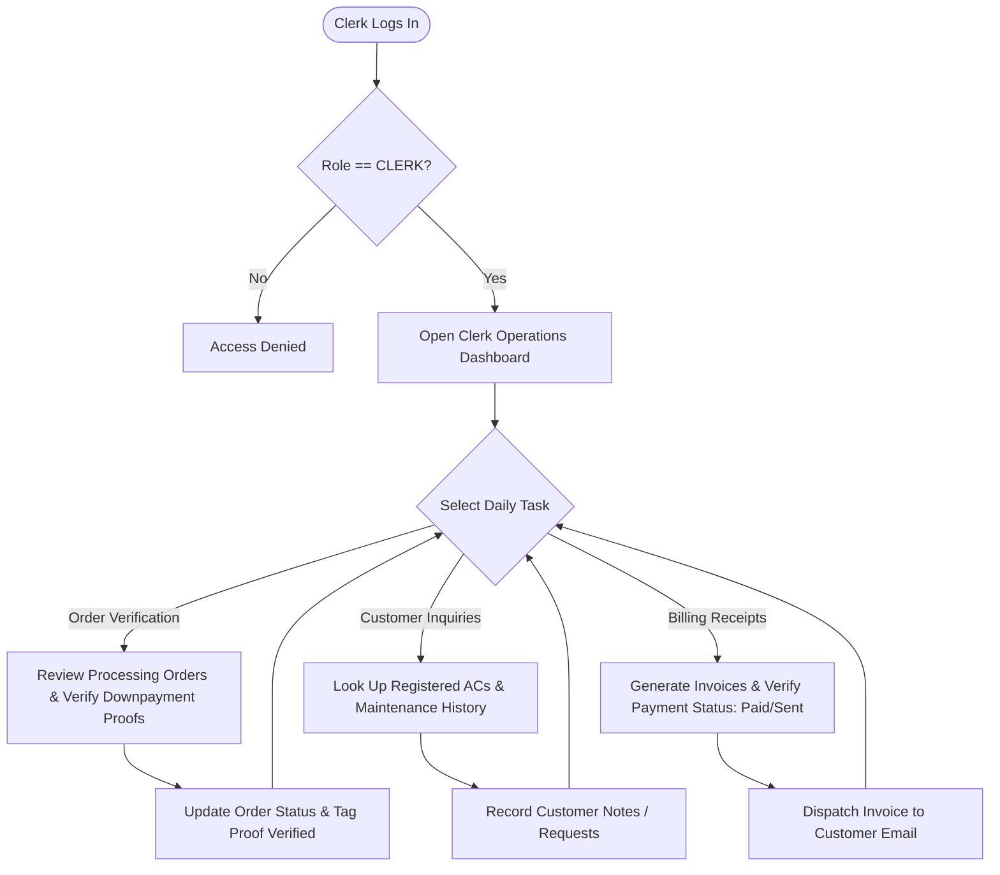

# FrostTech - System Architecture & Specification Diagrams

This document contains the complete software architecture diagrams for **FrostTech**, including the Level-0 System Context Diagram, Use Case Diagram, User Activity Flowcharts (Customer, Technician, Admin, Clerk), and the comprehensive Entity Relationship Diagram (ERD).

---

## 1. System Context Diagram (Level 0)

---

## 2. Use Case Diagram

---

## 3. User Flowcharts

### 3.1. Customer Process Flowchart

---

### 3.2. Technician Process Flowchart

---

### 3.3. Administrator Process Flowchart

---

### 3.4. Clerk Process Flowchart

---

## 4. Entity Relationship Diagram (ERD)

```mermaid
erDiagram
    users {
        String id PK
        String email UK
        String password
        String firstName
        String lastName
        String phone
        Role role "CUSTOMER | ADMIN | TECHNICIAN | CLERK"
        String techRank
        String permissions "JSON array of granted privileges"
        DateTime createdAt
        DateTime updatedAt
    }

    registered_acs {
        String id PK
        String userId FK
        String location
        String brandModel
        String acType
        String horsepower
        String paymentType
        Float totalPrice
        Int months
        Float pricePerMonth
        Float lat
        Float lng
        String fullAddress
        Boolean purchasedFromStore
        Boolean isPaused
        Boolean isEnrolledMaintenance
        DateTime enrolledAt
        DateTime createdAt
        DateTime updatedAt
    }

    products {
        String id PK
        String slug UK
        String name
        String brand
        String category
        Float price
        Float originalPrice
        Float rating
        Int sold
        String image
        StringArray images
        String horsepower
        String badge
        StringArray specs
        String description
        DateTime createdAt
        DateTime updatedAt
    }

    product_variants {
        String id PK
        String productId FK
        String condition "Brand New | Second Hand | On-Hand"
        Float price
        Int stock
        DateTime createdAt
        DateTime updatedAt
    }

    reviews {
        String id PK
        String productId
        String userId FK
        String userName
        Int rating
        String comment
        DateTime createdAt
        DateTime updatedAt
    }

    inventory_items {
        String id PK
        String sku UK
        String brand
        String model
        String category
        String horsepower
        String description
        Int stock
        Float price
        String image
        StringArray images
        String status
        DateTime createdAt
        DateTime updatedAt
    }

    orders {
        String id PK
        String orderNo UK
        String userId FK
        String name
        String location
        String item
        String payment
        String status
        String date
        String downpaymentProof
        Boolean hasDownpayment
        Boolean notice3Days
        DateTime notice3DaysAt
        String hp
        String itemType
        Float price
        String assignedTech
        String scheduledDate
        DateTime createdAt
        DateTime updatedAt
    }

    installments {
        String id PK
        String appId UK
        String userId FK
        String name
        String item
        String date
        InstallmentStatus status "PENDING | CI_ACCEPTED | REPENDING | COMPLETED | REJECTED"
        String issue
        Int term
        String employer
        String income
        String idType
        String location
        String assignedTech
        String scheduledDate
        DateTime createdAt
        DateTime updatedAt
    }

    dispatch_items {
        String id PK
        String dispatchNo UK
        String type
        String customerId
        String name
        String location
        String item
        String notes
        String status
        String scheduledDate
        String assignedTechName
        String horsepower
        DateTime createdAt
        DateTime updatedAt
    }

    maintenance_schedules {
        String id PK
        String scheduleNo UK
        String customerId FK
        String name
        String phone
        String address
        String item
        String serviceType
        String scheduledDate
        String technicianId FK
        String technicianName
        MaintenanceStatus status "SCHEDULED | OVERDUE | COMPLETED"
        String notes
        DateTime createdAt
        DateTime updatedAt
    }

    calendar_events {
        String id PK
        String title
        String date
        String technician
        String type
        DateTime createdAt
    }

    tech_requests {
        String id PK
        String reqId UK
        String technicianId FK
        String itemNeeded
        Int quantity
        String reason
        String status "Pending | Approved | Declined"
        DateTime createdAt
        DateTime updatedAt
    }

    addresses {
        String id PK
        String userId FK
        String label
        String fullAddress
        String phone
        Float lat
        Float lng
        Boolean isDefault
        DateTime createdAt
        DateTime updatedAt
    }

    cart_items {
        String id PK
        String userId FK
        String productId
        String name
        Float price
        String image
        Int quantity
        Boolean notice3Days
        DateTime notice3DaysAt
        DateTime createdAt
        DateTime updatedAt
    }

    invoices {
        String id PK
        String invoiceNo UK
        String type "ADMIN | CUSTOMER"
        String dispatchId
        String dispatchNo
        String customerName
        String serviceType
        String acUnit
        String location
        String technicianName
        String status "Sent | Viewed | Paid"
        Float amount
        String notes
        DateTime createdAt
        DateTime updatedAt
    }

    _TechnicianDispatch {
        String A FK "dispatch_items.id"
        String B FK "users.id"
    }

    %% Relationships
    users ||--o{ registered_acs : "owns"
    users ||--o{ orders : "places"
    users ||--o{ installments : "applies for"
    users ||--o{ addresses : "saves"
    users ||--o{ cart_items : "adds to"
    users ||--o{ maintenance_schedules : "requests as Customer"
    users ||--o{ maintenance_schedules : "assigned as Technician"
    users ||--o{ tech_requests : "submits as Technician"
    users ||--o{ _TechnicianDispatch : "assigned to"
    dispatch_items ||--o{ _TechnicianDispatch : "assigned crew"
    products ||--o{ product_variants : "has condition pricing"
```

